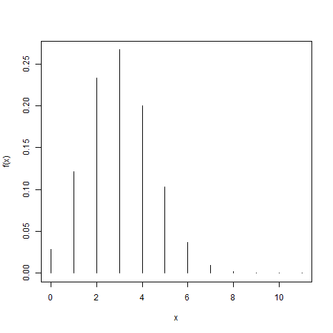
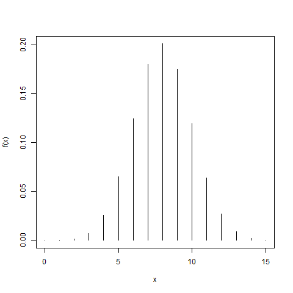

## Probability distributions in R

For most probability distributions, R provides **four types of functions**. The first letter of the function name indicates its purpose:

* `d` — probability mass function (discrete distributions) or probability density function (continuous distributions);
* `p` — cumulative distribution function;
* `q` — quantile function;
* `r` — generation of pseudo-random values.

The appropriate distribution name is appended to this letter. For example, for the normal distribution, the four functions are `dnorm()`, `pnorm()`, `qnorm()`, and `rnorm()`.

The following table lists some of the probability distributions available in **R**, together with their names used by R and function arguments.

| Distribution      | Name in R | Arguments         |
| ----------------- | --------- | ----------------- |
| Beta              | `beta`    | `shape1, shape2`  |
| Binomial          | `binom`   | `size, prob`      |
| Negative binomial | `nbinom`  | `size, prob`      |
| Cauchy            | `cauchy`  | `location, scale` |
| Exponential       | `exp`     | `rate`            |
| F (Snedecor)      | `f`       | `df1, df2`        |
| Gamma             | `gamma`   | `shape, scale`    |
| Geometric         | `geom`    | `prob`            |
| Hypergeometric    | `hyper`   | `m, n, k`         |
| Log-normal        | `lnorm`   | `meanlog, sdlog`  |
| Logistic          | `logis`   | `location, scale` |
| Normal            | `norm`    | `mean, sd`        |
| Poisson           | `pois`    | `lambda`          |
| Chi-squared       | `chisq`   | `df`              |
| Student's t       | `t`       | `df`              |
| Uniform           | `unif`    | `min, max`        |
| Weibull           | `weibull` | `shape, scale`    |

::: {.callout-tip}

## Probability Mass/Density Functions: `dname()`

For a **discrete** random variable, `dname()` returns the *probability mass* at a given value. For a **continuous** random variable, it returns the value of the *probability density function*.

:::

For example, suppose
$$
X \sim \operatorname{Binomial}(10,0.45).
$$
To calculate $P(X=3)$:

```r
dbinom(3, size = 10, prob = 0.45)
```

::: {.callout-tip}

## Cumulative Distribution Function: `pname()`


The `pname()` family of functions returns the cumulative probability $P(X \leq q)$.

:::

For example, suppose
$$
X \sim N(8.5,2.3^2).
$$
To calculate $P(X\leq10)$:
```r
pnorm(10, mean = 8.5, sd = 2.3)
```

::: {.callout-tip}

## Quantile Function: `qname()`

The `qname()` family provides the inverse of the cumulative distribution function. Given a probability $p$, it returns the value $q$ such that
$P(X\leq q)=p$.

:::

For example, if
$$
Z\sim N(0,1),
$$
the value $q$ satisfying $P(Z\leq q)=0.975$ is obtained with:
```r
qnorm(0.975, mean = 0, sd = 1)
```
::: {.callout-tip}

##  Generating Pseudo-Random Values: `rname()`

The `rname()` family generates pseudo-random observations from a specified probability distribution.
:::

For example, the following command generates **1000 observations** from a normal distribution with mean $-4$ and standard deviation $2$:

```r
rn <- rnorm(1000, mean = -4, sd = 2)
```

Thus, once the R name of a distribution is known, its main functions are easy to identify. For example, the binomial distribution uses `dbinom()`, `pbinom()`, `qbinom()`, and `rbinom()`, while the normal distribution uses `dnorm()`, `pnorm()`, `qnorm()`, and `rnorm().


## Discrete distributions {#ddistr}

In the next section, you will work through a set of simple exercises on using probability functions in R. The following section includes more challenging exercises involving discrete probability distributions.


### Exercises about probability functions in R


In the following exercises, you will practice using the R functions `dname()`, `pname()`, `qname()`, and `rname()`. Write the appropriate code or fill in each blank with the appropriate value.


:::: {.panel-tabset}

## **Binomial**

::: {.column-margin}



:::

Let $X\sim Bin(10,0.3)$. Find $P(X=3)$.

```{webr-r}
____binom(3,10,0.3)
```

## Hint

::: { .hint}
Consider using the `dbinom()` function.

:::

## Solution

::: { .solution}

```{r}
dbinom(3,10,0.3)
```

1. Remember the function starting with a `p` means that you are either computing the mass or the density function;
2. The name of the distribution is `binom`.

:::

::::

:::: {.panel-tabset}


## **Hypergeometric**

Let $X\sim H(100,40,20)$. Find $P(X\leq
10)$.


::: {.column-margin}


:::


```{webr-r}
phyper(q = ___,m = ___,n = ___,k = ___)
```

## Hint

::: { .hint}

Consider a population of size $100$, containing $40$ successes. A sample of size $20$ is drawn from this population.

:::

## Solution

::: { .solution}

```{r}
phyper(q = 10,m = 40,n = 60,k = 20)
```


:::

::::

:::: {.panel-tabset}


## **Geometric**

Let $X\sim G(0.6)$. Find $P(X>5)$.

```{webr-r}

```

## Hint

::: { .hint}

$P(X>5)=1-P(X\leq5)$

Then, use `pgeom()` function.

:::

## Solution

::: { .solution}

```{webr-r}
1-pgeom(5,0.6)
```


:::

::::


:::: {.panel-tabset}


## **Poisson**

Let $X\sim P(6)$. Find $P(X=4)$.

```{webr-r}

```

## Hint

::: { .hint}

Use `dpois()` function.

:::

## Solution

::: { .solution}

```{webr-r}
dpois(4,lambda = 6)
```


:::

::::

### Other exercises

The following questions are generated from the R/exams sources in the `exercisesRexams` folder. The answer order may change when the book is rendered.


:::: {.panel-tabset}

## Question 1

```{r}
#| echo: false
#| results: "asis"
#| message: false
exams2forms::exams2forms(
  file = "./exercisesRexams/binomial11.Rmd",
  title = "Binomial interval probability",
  solution = FALSE,
  browse = FALSE
)
```

```{webr-r}
#| classes: exercise-workspace
```

## Solution

::: {.solution}

```{webr-r}
pbinom(4, size = 18, prob = 0.25) -
  pbinom(1, size = 18, prob = 0.25)
```

:::

::::


:::: {.panel-tabset}

## Question 2

```{r}
#| echo: false
#| results: "asis"
#| message: false
exams2forms::exams2forms(
  file = "./exercisesRexams/poisson11.Rmd",
  title = "Poisson motorhome demand",
  solution = FALSE,
  browse = FALSE
)
```

```{webr-r}
#| classes: exercise-workspace
```

## Solution

::: {.solution}

```{webr-r}
c(
  one_not_rented = dpois(7, lambda = 3),
  total_in_two_weeks = dpois(8, lambda = 6)
)
```

:::

::::


:::: {.panel-tabset}

## Question 3

```{r}
#| echo: false
#| results: "asis"
#| message: false
exams2forms::exams2forms(
  file = "./exercisesRexams/poisson12.Rmd",
  title = "Poisson unrented vehicles",
  solution = FALSE,
  browse = FALSE
)
```

```{webr-r}
#| classes: exercise-workspace
```

## Solution

::: {.solution}

```{webr-r}
c(
  probability = dpois(6, lambda = 3.5),
  expected_four_weeks = 4 * 3.5
)
```

:::

::::

## Continuous distributions {#cdistr}
