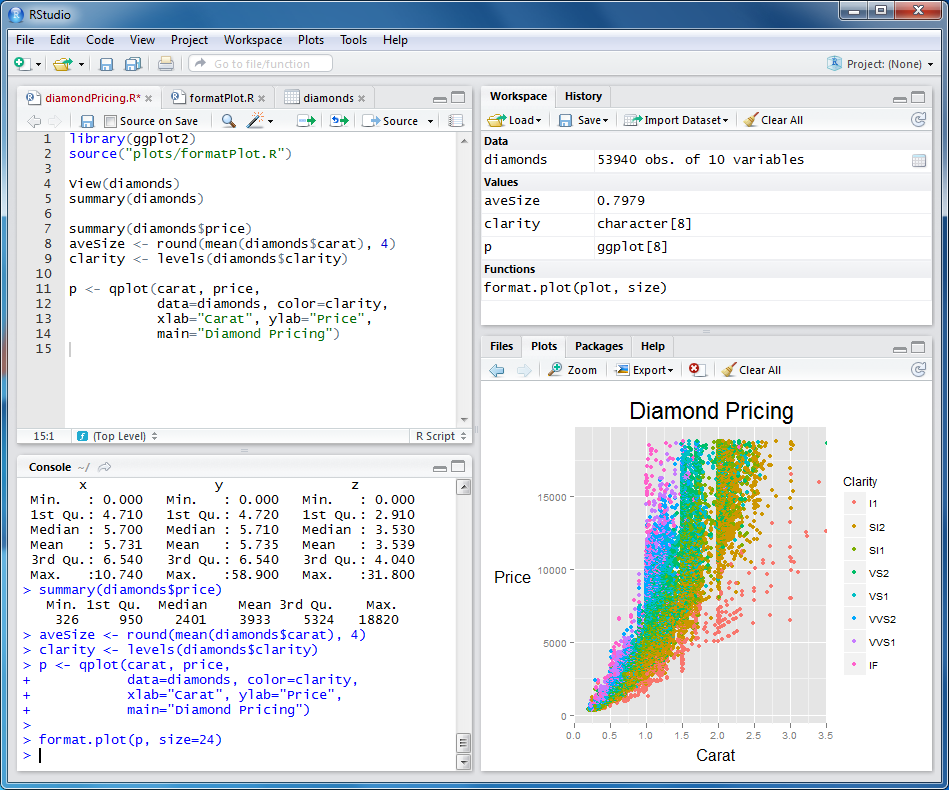
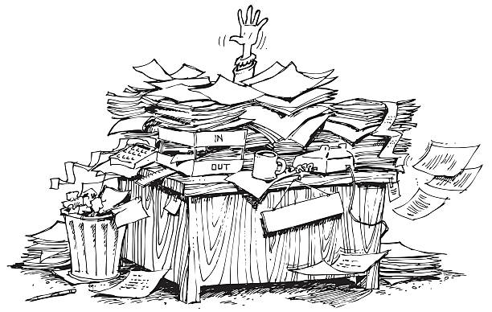

# Introduction to R and RStudio

This section contains a brief introduction to R and RStudio.

## What is R? {#whatR}

::: {.column-margin}

:::

**R** is both a programming language and a software environment for **statistical computing, data analysis, and data visualization**. It is widely used in statistics, data science, research, and education.

Some of its main features include:

* efficient tools for **manipulating, exploring, and analysing data**;
* extensive **data visualization** capabilities for producing high-quality graphics;
* a comprehensive collection of **statistical methods**, including tools for exploratory data analysis, statistical inference, modelling, and simulation;
* powerful and flexible tools for **data manipulation and analysis**;
* continuous development supported by a worldwide community of researchers and developers, with the core development of R coordinated by the **R Core Team**;
* free distribution as **open-source software**;
* access to a vast ecosystem of additional **packages** that extend R's functionality.

You can find the official website of the R Project at [https://www.r-project.org/](https://www.r-project.org/). The main repository for R packages is the **Comprehensive R Archive Network (CRAN)** [(https://cran.r-project.org/)](https://cran.r-project.org/).

## What is RStudio? {#whatRStudio}

::: {.column-margin}

:::

**RStudio** is an **Integrated Development Environment (IDE)** designed to make working with R easier and more convenient.

It is important to distinguish between **R and RStudio**: **R is the programming language and computational environment**, whereas **RStudio is an application that provides a user-friendly interface for working with R**. It makes it easier to write and run code, manage files, inspect data, create and view plots, install and manage packages, and access documentation.

Some of the main advantages of RStudio are:

* you can **write, edit, and save code** in script files;
* it makes it easy to **run R commands and scripts**;
* it brings together the **source editor, console, plots, files, packages, environment, and help system** in a single interface;
* it provides useful programming features such as **syntax highlighting, keyboard shortcuts, and code completion**;
* it helps you organise your work and encourages **reproducible analyses**.

RStudio Desktop can be downloaded from the official **Posit** website at [https://posit.co/download/rstudio-desktop](https://posit.co/download/rstudio-desktop).

## Documentation {#doc}

::: {.column-margin}

:::

One of the advantages of R is the **extensive documentation and learning resources** available to users. In addition to the documentation built into R itself, there are official manuals, textbooks, tutorials, reference materials, and many other resources developed by the R community.

### R Manuals

The official R documentation provides comprehensive information about the language, its statistical and graphical capabilities, and its internal structure. The main manuals include:

* *An Introduction to R* — an introduction to the R language and its main features;

* *R Data Import/Export* — guidance on importing data into R and exporting data from R;

* *R Language Definition* — a detailed description of the R programming language;

* *Writing R Extensions* — documentation primarily intended for developing R packages and other extensions;

* *R Internals* — a technical description of the internal structure and implementation of R;

* *R Installation and Administration* — information on installing, configuring, and administering R.

The official manuals are available from the **Comprehensive R Archive Network (CRAN)** at [https://cran.r-project.org/manuals.html](https://cran.r-project.org/manuals.html)

### Books and Learning Resources

There are also several excellent books and online resources that are freely available. The following are particularly useful for learning R and applying it to data analysis, probability, and statistics:

* [R for Data Science (2nd Edition)](https://r4ds.hadley.nz/), by Hadley Wickham, Mine Çetinkaya-Rundel, and Garrett Grolemund — a modern introduction to working with data in R. It covers data visualization, data transformation, importing data and programming.

* [Statistical Inference via Data Science: A ModernDive into R and the Tidyverse (2nd Edition)](https://moderndive.com/v2/), by Chester Ismay, Albert Y. Kim, and Arturo Valdivia — an accessible introduction to statistical inference using R. It integrates statistical concepts with data analysis and provides numerous examples and exercises. It is particularly useful for students taking an introductory course in probability and statistics.

These three resources are particularly recommended as companions to this tutorial. **R for Data Science** is especially useful for learning how to work with data in R, while **ModernDive** and **Introduction to Modern Statistics** provide a closer connection between R and the statistical concepts covered in this course.

### Additional Resources

The following freely available resources may also be useful for further study or as reference material:

* [Advanced R (2nd Edition)](https://adv-r.hadley.nz/), by Hadley Wickham — a more advanced treatment of the R language, recommended for readers interested in understanding R programming in greater depth.

* [*Using R for Data Analysis and Graphics — Introduction, Code and Commentary*](https://cran.r-project.org/doc/contrib/usingR.pdf), by John Maindonald — examples and explanations of statistical analysis and graphics using R;

* [*Practical Regression and Anova in R*](https://julianfaraway.github.io/faraway/PRA/), by Julian Faraway — a practical introduction to linear regression, analysis of variance, model diagnostics, transformations, and related methods using R;

* [*R for Beginners*](https://cran.r-project.org/doc/contrib/Paradis-rdebuts_en.pdf), by Emmanuel Paradis — a concise introduction to R aimed at readers with little or no previous experience with the language;

* [*R Reference Card*](https://cran.r-project.org/other-docs.html), by Tom Short — a compact reference summarising commonly used R functions and syntax, including commands for data manipulation, statistics, graphics, and programming;

* [*The R Inferno*](https://www.burns-stat.com/pages/Tutor/R_inferno.pdf), by Patrick Burns — an entertaining and useful guide to common pitfalls, unexpected behaviour, and programming mistakes in R.

These resources may use older R conventions or workflows that differ from best current practices, but they remain useful as supplementary references.

